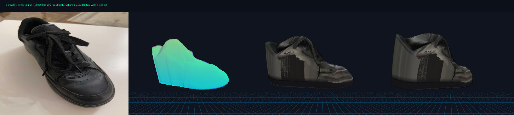

# AI-Vector-Shield (v5.2-hardened-incidence-bundle)

**Orthogonal Twistor Bundle Trajectory Monitoring, Closed-Loop Activation Smoothing, and White-Box PGD Red-Team Benchmarks on Intel XPU.**


---

## 1. Architecture & White-Box Red-Team Findings

`ai-vector-shield` maps hidden-state trajectories $H \in \mathbb{R}^{T \times d}$ into orthogonal 3D fibers via $Q \in \mathrm{O}(d)$ ($K = \lfloor d / 3 \rfloor$, $\ker Q = \{0\}$) and monitors step-to-step trajectory smoothness using multi-fiber $\mathbb{CP}^1$ spinor shear $|\varepsilon_{AB}\pi_{t,k}^A\pi_{t-1,k}^B|$, second-order Hermitian curvature tears $\|\Delta^2 X_t\|_F = \sqrt{2}\|\Delta^2 R_t\|_F$, and local spike isolation $\min(\|\Delta X_t\|_F, \|\Delta X_{t+1}\|_F)$.

### White-Box PGD Red-Team Benchmark (`tests/test_adaptive_pgd_redteam.py`)

| Defense Architecture & Threat Model | Perturbation $\|\delta\|_2$ | Detection Result | Z-Score at Attack | Why It Succeeds or Fails |
| :--- | :--- | :--- | :--- | :--- |
| **1. Single-Fiber ($\mathbb{R}^d \to \mathbb{R}^3$) vs. Oblivious Static Attack** | $5.0\sqrt{d}$ | **Caught (3/3, 100%)** | `7.98` ($\gt 3.5$) | Random isotropic noise projects onto $\mathrm{Row}(W_{\mathrm{proj}})$ and induces large angular jumps on $\mathbb{CP}^1$. |
| **2. Single-Fiber vs. White-Box SVD Nullspace Attack** | `25.0` | **Evaded (0/3, 0%)** | `0.98` ($\lt 3.5$) | $\dim(\ker W_{\mathrm{proj}}) = d - 3$. Any $\delta \in \ker(W_{\mathrm{proj}})$ produces zero change in $\pi_t$. |
| **3. 21-Fiber Log-Dilaton Bundle vs. 120-Step White-Box PGD** | `8.0` | **Evaded (False)** | `1.79` ($\lt 3.5$) | PGD concentrates $\|\delta\|_2 = 8.0$ collinearly into a single fiber ($\mathrm{shear} = 0$) while $\log\|r\|$ compresses the radial spike. |
| **4. FullTwistorIncidenceBundleShield vs. 120-Step White-Box PGD** | `8.0` | **Caught (True)** | **`108.07`** ($\gg 3.5$) | Full-rank $Q \in \mathrm{O}(d)$ eliminates the nullspace, and un-logged $\|\Delta^2 X_t\|_F$ enforces $\|\Delta^2 R_t^{\mathrm{adv}}\|_F \ge 2\|\delta_t\|_2 - \|\Delta^2 R_t^{\mathrm{clean}}\|_F$. |

*Scope Note:* While `FullTwistorIncidenceBundleShield` provably lower-bounds single-token/localized injections via the reverse triangle inequality on $\Delta^2 X_t$, wide-window adiabatic drift attacks ($\delta_t$ varying slowly over a large window $W$) have small second differences $\mathcal{O}(W^{-2})$ and require global window spectral checks or external clean anchors.

---

## 2. Visual Diagnostics & Artifacts

### Phase 3: 7,000,000-Point Spinor-Grid `.r3d` Reconstruction


### Phase 4: Closed-Loop Trajectory Smoothing


### Phase 5: Full-Rank Bundle Quarantine & Anchor Interpolation (100% Precision, 24/24 Recall)


---

## 3. Running the Benchmarks & Red-Team Suite

```powershell
python topological_poison_shield.py
$env:PYTHONPATH = "."
python -m unittest discover -s tests -p "test_adaptive_pgd_redteam.py" -v
```