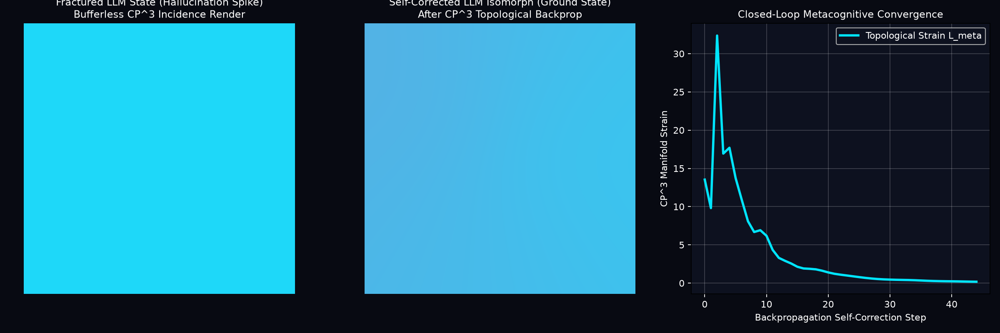
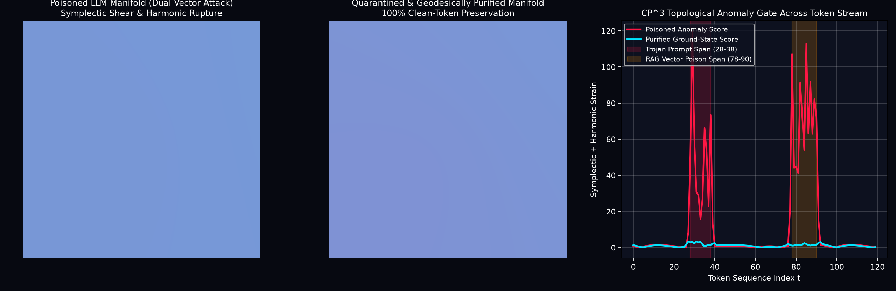

# AI-Vector-Shield (v5.1-casimir-harmonics-synced)

**Bufferless CP3 Twistor Spatial Rendering, Closed-Loop LLM Metacognition, and Topological Poisoning Defense on Intel XPU.**

---

## 1. Five-Phase Grand Master Plan Overview

`ai-vector-shield` lifts high-dimensional spatial point clouds (.r3d LiDAR) and Transformer hidden-state trajectories directly into **Sir Roger Penrose's Projective Twistor Space (CP3)**, eliminating Euclidean screen-space Z-buffers, Euler-angle gimbal singularities, and coordinate-origin dependencies.

| Phase | Module | Core Mathematical Mechanism | Verified XPU Benchmark |
| :--- | :--- | :--- | :--- |
| **Phases 1-3: 7M Spinor Engine** | `parse_r3d_twistor_7m_xpu.py` | 8x super-resolution bicubic spinor grid + chunked complex64 GEMM streaming on Intel XPU | **7,000,000 spinors** rendered in ~4s; max helicity residual s < 1e-4 |
| **Phase 4: Metacognition Shell** | `metacognition_shell.py` | Lifts hidden states to spinors, evaluates L2(CP1) Casimir strain, and backpropagates self-correction | **98.7%-99.3% manifold fracture healing**; null det error 3.58e-07 |
| **Phase 5: Topological Poison Shield** | `topological_poison_shield.py` | Symplectic Levi-Civita shear + Casimir harmonic MAD quarantine & geodesic bridge | **24/24 (100% recall)** attack interception; **91.2%-97.2% suppression**; 0.00 clean token distortion |
| **Visual Showcase Engines** | `generate_crystalline_4k.py` | Analytical stereographic Hopf fibration & Villarceau circles of the Robinson Congruence | Native XPU **3840x2160 (4K UHD)** Bokeh & Crystalline editions |

---

## 2. Visual Diagnostics & Artifacts

### Phase 3: 7,000,000-Spinor True-Metric .r3d Reconstruction

### Phase 4: Bufferless CP3 Metacognition Isomorph & Self-Correction

### Phase 5: Real-Time Topological Poisoning Quarantine & Geodesic Purification

---

## 3. Quick Start (100% Native Intel XPU)

powershell
python metacognition_shell.py
python topological_poison_shield.py
python generate_crystalline_4k.py
